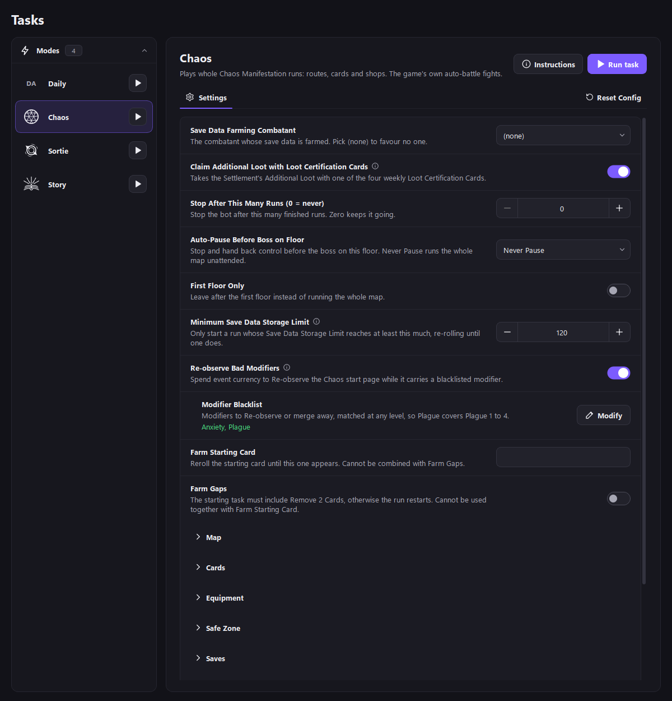

<div align="center">
  <h1 align="center">
    
    <br/>
    CZN Auto+
  </h1>

  <p>
    Automation for the Global (English) PC client of Chaos Zero Nightmare. It does your daily chores and plays Chaos
    Manifestation, Sortie and Story for you by reading the screen and pressing buttons, built on
    <a href="https://github.com/ok-oldking/ok-script">ok-script</a>.
  </p>

  <p><i>It only simulates mouse and keyboard input. It never reads game memory or touches game files.</i></p>
</div>

<div align="center">


[](CHANGELOG.md)

</div>

- **Daily:** claims attendance, all mail, the ready Activity rewards and achievements, the Nightmare Carnival's attendance and The
  Path of a Captain's tiers, runs Nightmare Dream Park with the park's own profit while the event is on, and promotes and
  levels the Combatants you name from materials you already own.
- **Chaos Manifestation:** walks from the Lobby to The Blue Pot and plays whole runs: routes, events, cards, shops,
  equipment and fights.
- **Sortie:** plays whole Sortie runs and picks every card in its fights itself.
- **Story:** skips story scenes, plays story fights and a chapter's open Battle Missions, and hands a chapter's Chaos
  stage to Chaos mode and back.
- **Safe by default:** stops instead of spending Crystals or money, deleting saves or abandoning a run nobody asked to
  leave. See [what the bot changes on your account](#what-the-bot-changes-on-your-account).
- **Tells you why it stops:** most stops raise a Windows notification with the reason and what to do; the
  [few that do not](#stops-and-notifications) are logged.

**Get started:** follow [Install](#install) and [Before your first run](#before-your-first-run). Use at your own risk:
read the [disclaimer](#disclaimer).

> [!NOTE]
> CZN Auto+ by lhceist41 is built on [steve1316/ok-czn-english](https://github.com/steve1316/ok-czn-english), which
> started as a fork of [baoxin1100/ok-kes](https://github.com/baoxin1100/ok-kes). It is built and tested for the
> **Global PC client** only. It has drifted far enough from ok-kes that the Chinese clients will likely run into
> trouble, so use ok-kes for those.

## Disclaimer

A free tool for personal use. Use it at your own risk: this project is not responsible for anything that happens to
your account.

## Requirements

- Windows, and the Global PC client of Chaos Zero Nightmare, started through STOVE.
- The game at 16:9, at least 1280x720 (1920x1080 works well).
- Administrator rights: the game runs elevated, so without them Windows silently drops every click the app sends.
- For now, [Git](https://git-scm.com/) and [Python 3.12](https://www.python.org/downloads/).

## Install

There is no installer yet, so the app runs from source. Open **PowerShell as Administrator**, then run these. The first
line puts the app in `czn-auto-plus` inside your user folder; change it to put the app somewhere else.

```powershell
cd $HOME
git clone https://github.com/lhceist41/czn-auto-plus.git
cd czn-auto-plus
py -3.12 -m venv .venv
.\.venv\Scripts\Activate.ps1
pip install -r requirements.txt
python main.py
```

Next time, open PowerShell as Administrator, run `cd $HOME\czn-auto-plus`, then `.\.venv\Scripts\Activate.ps1` and
`python main.py`.

If PowerShell refuses to run `Activate.ps1`, run `Set-ExecutionPolicy -Scope Process Bypass` in that window first. It
lasts only for that window and changes nothing permanent.

To update, run `git pull` in the folder, then `pip install -r requirements.txt` again.

## Before your first run

1. **Show Keybinds:** in the game's Settings, Keybinds tab, set **Show Keybinds** to ON. The fights the bot plays
   itself (Sortie, Story fights, and Chaos fights before Captain Lv 30) play cards by these keys.
2. **Game Language:** keep it on **English** on the app's Settings page. If it does not match the game, the run stops
   and says what to change.
3. **Story Auto and Fast Forward:** nothing to set. The bot presses Skip on story scenes and turns the dialogue bar's
   Auto and Fast Forward on by itself.
4. **Start screen:** open the screen the mode starts from, pick the mode on the **Tasks** page and press **Run task**.

| Mode | Start it on |
| --- | --- |
| Daily | The Lobby |
| Chaos | The Lobby, the Chaos hub, the Chaos Manifestation map, or the prompt to resume a run still open |
| Sortie | Sortie's own screens in the game |
| Story | Inside Story, on a chapter |

## The app



Pick a mode on the left. Its settings open on the right, and **Run task** starts it. Only one mode runs at a time.

Once Chaos or Sortie has run, an **Info** tab shows how the run went: time elapsed, the last thing the bot did, floor,
credits, runs against your stop limit, one row per combatant with their equipment, and the cards removed and gained
this run.

The **Settings** page holds the settings shared by every mode:

- **Game Language:** the language the game shows. English for the Global client.
- **OCR Backend:** how the screen is read. Auto uses ONNX Runtime; OpenVINO is an option on Intel machines. Restart the
  app after changing it.
- **Input Variance:** spreads clicks around the middle of each button, varies how long each press is held and waits a
  short reaction delay before acting on a new screen, all on by default. Breaks are off by default.
- **Auto Analysis:** off by default. Records what the game's own Auto plays, for studying it.

## Modes

### Daily

Starts on the Lobby and closes its entry popups, claims the daily attendance reward and all mail, then the rewards that
read ready in the Activity window (Growth Guide, the daily and weekly schedules, Achievement Log) and on the Achievement
screen (Claim All in each category). While the Nightmare Carnival runs it opens it from the Lobby's banner and claims
every pending attendance day, never Check-In Make-Up or the Exchange. In the Event list it claims each reached tier of
The Path of a Captain, then visits Nightmare
Dream Park while the event runs. In the park it ranks up, builds and upgrades rides, buys the park skills AI Automation
and Another Happy Day and claims the park's achievements, all with the park's own profit: it presses a price only when it
reads as park profit, and stops on a Crystal or money price. Daily stops on the Lobby and presses nothing else.

With **Goal Combatants** set, Daily ends by investing in them, one at a time in the list's order, from materials and Units
you already hold: each one's Promotion, Level Up to the cap, its Partner's Promotion and Level Up, and Potential node 01,
plus node 02 for the first in the list. It presses a spend only when the game's own button reads Promotions, Level Up or
Activate, the counter shows enough and the Units left stay at or above **Units to Keep** (300,000 by default). It never
merges, replenishes, dismantles or buys, so a button offering one of those counts as short. Each Combatant and Partner is
promoted at most once a run, and a Combatant later in the list is not levelled while one before it is below its level cap
or has a Promotion ready that only Units to Keep holds back, so the Combat Memories, Support Data and Units the first can
use stay for it. What each one is
still short of is written to `data/farm_goals.json` and named in the finish message. The file is written again each time
Daily learns more, so a stop keeps what was read (a stop before Daily first writes it leaves the file from the run
before). It marks each Goal Combatant `visited`, `partial` or `unvisited`. The marks say how far each visit got, not
that every panel was read: any Combatant may be short of more than its lines show, above all one marked `partial`. A
Promotion panel whose button does not read Promotions is left by its back arrow even when its counter does not read;
where the finish message names it as short, it says "counter unread". A Combatant whose card is not on the Combatant
List's visible row is skipped. Empty, the default, skips this step.

### Chaos Manifestation

- Started on the Lobby, the Chaos hub or the Chaos Manifestation map, it walks to **The Blue Pot** and starts there.
  On the prompt to resume an open run it presses only Enter. Other Chaos maps are not walked to yet.
- Plays whole runs: routes, Unidentified Areas, card rewards, removals, Epiphanies, shops, Safe Zones and equipment.
- The game's own auto-battle unlocks at Captain Lv 30, and from then the bot turns it on. Until then the bot plays the
  cards itself, as in Sortie, and stops the run if a fight makes no progress for 3 minutes.
- Re-observes the Chaos start page while it carries a modifier on your blacklist (Anxiety and Plague by default), as
  far as your event currency allows. On by default.
- Can hunt a Zero System Codex for the Chaos, season and save limit you want.
- Handles the season mechanics: Season 3 Persona cards, the Season 4 **Desire Faction** you pick, and Season 5 Memory
  cards and End of Memory.
- Claims the Settlement's Additional Loot with the weekly Loot Certification Cards only.
- Stops after a set number of runs, or pauses before a chosen boss so you can take over. **First Floor Only** does not
  leave a run yet: after the first floor the run waits on its menu until the five-minute stop ends it.

### Sortie

- Plays whole Sortie runs and fights every battle itself. **Smart Card Play** spends each turn's Action Points on the
  cards worth the most, from each card's cost, type and effect text, and finishes an enemy a sure attack can kill
  first.
- Each combatant has their own kit, so the bot knows what their cards combo with.
- Drafts combatants by your priority list, or by role when you have not set one.
- Claims the Chaos Loot at the end with Reason only, never charging Reason with Aether.

### Story

- Presses Skip on story scenes and plays story fights.
- Plays a chapter's open Battle Missions left to right on the game's Auto.
- Hands a chapter's Chaos stage to Chaos mode and takes the chapter back once the run ends. That run spends and
  deletes nothing, whatever your Chaos settings say.
- Stops at a lock, at a Battle Missions list with nothing open, at the growth tutorial and on the Lobby.

## Cards and equipment

- **Epiphanies** go on a card your build preset pinned when one is offered, then on a card from your list, and
  otherwise on the strongest card that has none yet. When every card already carries one, only a listed card takes it.
- **Removals** follow your list and keep pinned cards. **Copies** take only cards on your list.
- **Meditation**, at a Safe Zone, re-rolls the Epiphany on a card your build preset pinned. On by default.
- **Monster Cards** can be bought in shops or skipped as rewards, each on its own switch.
- **Equipment** goes to the combatant the game marks "Recommended", and a Mythic piece is never passed over. Extracting
  spare equipment for Credits is off by default.

## What the bot changes on your account

- **Never:** it is built never to spend Crystals or money. A dialog that would spend account currency, delete or
  retreat when nobody asked is cancelled and the run stopped. It never presses a run's Escape, never taps Skip
  Tutorial, and stops on every Rescue screen without pressing anything, so pulls stay your choice.
- **Spends inside a run:** in-run Credits on shops, card removals, Meditation and Extract. A shop is never rerolled for
  Credits after its free refreshes unless you set a threshold.
- **May spend outside a run:** event currency for Re-observe (on by default), and Credits or Chaos Orbs for Zero System
  merges, up to 3 per Codex by default. Daily spends Dream Park's own profit and, for the Goal Combatants you set, the
  Units, Manuals, certificates, Combat Memories, Support Data and Growth Stones a Promotion, Level Up or Potential node
  costs, never below Units to Keep.
- **Weekly and daily items:** Loot Certification Cards for Chaos loot and Reason for Sortie loot. When they run out, the
  rest of that run's loot is left; Aether is never used.
- **Deletes only what you set:** after a run it can delete stored saves worth a size you set or less. The default, 0,
  keeps every save. **Treat Breakdown**, which spends a Communication Pass or gold to treat a Mental Breakdown, is off
  by default.
- **Game prompts:** it ticks "Do not show" on both Story skip dialogs (until your next login) and on Battle Prep (for
  the day).
- **Your settings stay on your PC:** the config sharing the base project offers is switched off.

## Stops and notifications

The app sends a Windows notification:

- when a mode starts, and when a Chaos or Sortie run finishes;
- in Chaos and Sortie, after a minute on one unchanged screen, repeated every few minutes while it lasts;
- when the bot stops a mode with a message of its own, with the reason and what to do: for example a dialog that would
  spend or delete, Skip Tutorial, the five-minute stop below, Daily's stops, and Sortie started on the Lobby, or Chaos
  when it cannot walk from there.

A few stops the base project makes on screens a mode does not handle send no notification and show only in the log:
Story on the Lobby, and the Ark City screen.

Every mode stops once the screen has not changed for five minutes.

**Leave the mouse alone over the game while it runs.** Each click borrows your cursor and puts it back, and keys move it
to an empty strip of the screen, so your own mouse movement can land a click somewhere else.

## Settings

Every setting has an English name and description. The everyday ones sit at the top, and the rest fold into sections
in the order a run meets them: Map, Battle, Cards, Equipment, Safe Zone, Saves, one per season, and Zero System. A
**Changed** tag marks anything you moved off its default, and a folded section counts its changes.

Card, combatant and equipment lists are picked from the game's own names, so a typo can never quietly stop a setting
from working. Hover an option to see what it does in game. A few keyword settings, such as the Unidentified Area
options, stay free text.


## Troubleshooting

1. **Clicks do nothing:** start the app from a PowerShell opened as Administrator.
2. **Antivirus:** add the folder you run the app from to your exceptions, Windows Defender included.
3. **Wrong reads:** keep **Game Language** on English, turn off graphics card filters and sharpening, keep the game's
   default brightness, and close overlays that draw over the game.
4. **Resolution:** run the game at 16:9, at least 1280x720.
5. **Still stuck:** update (`git pull`, then `pip install -r requirements.txt`) and try again.

---

## Developer Zone

### Running from source

Use Python 3.12 in a `.venv` inside the checkout. In PowerShell:

```powershell
py -3.12 -m venv .venv
.\.venv\Scripts\Activate.ps1
pip install -r requirements.txt -r requirements-dev.txt

python main.py          # release mode
python main_debug.py    # debug mode, with extra logging and a local control port
```

```powershell
.\run_tests.ps1         # every tests\Test*.py, in one process bar the manifest check
```

### Layout

| Path | Holds |
| --- | --- |
| `ok_tasks/` | The original game automation, treated as vendored |
| `src/en/` | Everything this fork changes, applied as runtime patches |
| `src/en/kits/` | One module per combatant's kit |
| `i18n/` | The two translation catalogs |
| `scripts/` | Offline tools, not shipped |

Local files the app writes: `configs/` (your settings), `logs/`, `screenshots/` (emptied at each start) and
`data/fights.jsonl`, a record of every fight the bot plays itself, kept to two files of about 8 MB at most.

### Translations

The two catalogs under `i18n/` run in **opposite directions**:

| Catalog | Direction | Holds |
| --- | --- | --- |
| `ok.po` | Chinese to English | The app's own labels, mode names and setting descriptions |
| `ocr.po` | English to Chinese | Game text read off the screen, rewritten into the Chinese the handlers compare against |

> [!CAUTION]
> **Never put UI strings in `ocr.po`.** It rewrites what the bot reads, so a stray entry there breaks recognition.

The app only reads the compiled `.mo` files, so run `python scripts/compile_i18n.py` after editing a `.po`.

### Offline tools

| Script | Does |
| --- | --- |
| `scripts/capture_window.py <name>` | Saves the game window to `captures/<name>.png` |
| `scripts/ocr_dump.py <image>` | Prints what OCR reads, marking text `ocr.po` does not cover yet |
| `scripts/check_vocab.py` | Reports how much of the handlers' Chinese `ocr.po` covers |
| `scripts/check_points.py <dir>` | Finds hardcoded click points that no longer land on text |
| `scripts/replay_fights.py` | Re-runs the card picker over recorded fights and reports where its choices changed |
| `scripts/study_auto.py` | Reports how often the card picker would choose what the game's own Auto played |
| `scripts/render_readme_images.py` | Renders this README's app images from the real widgets, with no game |

### Releases

This fork has no releases yet.

What changed so far, newest first: [CHANGELOG.md](CHANGELOG.md).

## Credits

* [steve1316/ok-czn-english](https://github.com/steve1316/ok-czn-english) - the project CZN Auto+ is built on
* [baoxin1100/ok-kes](https://github.com/baoxin1100/ok-kes) - the original project, and the app icon
* [ok-script](https://github.com/ok-oldking/ok-script)
* [OnnxOCR](https://github.com/ok-oldking/OnnxOCR)
